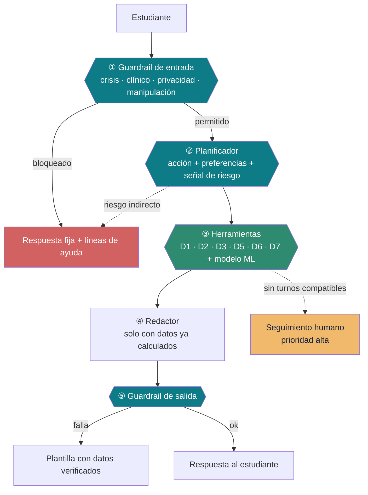

# Aethera Pulse + Ruta

**Entregable 2 · Desafío Ciudad Aethera · Misión M5: estigma y baja búsqueda de ayuda**

> Convierte *«necesito ayuda»* en **una cita que el estudiante realmente puede cumplir.**

[](https://www.python.org/)
[](https://www.gradio.app/)
[](FICHA_IA_RESPONSABLE.pdf)
[](docs/FICHA_IA_RESPONSABLE.md)
[](docs/INSTALACION.md)

Prototipo de un asistente de orientación **no clínica** que traduce lenguaje cotidiano a
motivos no clínicos, y propone citas compatibles con la agenda real del estudiante. Datos
100 % sintéticos del Data Pack provisto por la organización.

---

## El problema en una cifra

El **68 %** de los estudiantes con sintomatología ansiosa moderada-alta de UNI_NOVA_AETHER
—1 868 de 2 739— **nunca ha consultado un servicio de apoyo**.

No es que no busquen ayuda. Al analizar las 2 500 conversaciones de la línea de
orientación (D5) se observa que el **62 % escribe fuera del horario de atención** y el
**50 % llega entre las 18:00 y las 06:00**. Llegan cuando ya no hay nadie.

Y cuando la información sí está disponible, sigue sin servir:

| Medida | Valor |
|---|---|
| Turnos que muestra un directorio estático, por estudiante | **370** |
| De esos, compatibles con su horario | **28,2 %** |
| **Mediana de turnos realmente viables** | **0** |

El estudiante que más necesita ayuda es el que tiene que revisar 370 opciones para
encontrar, en el mejor caso, **una**.

---

## Qué hace

**Pulse** — Registro de ánimo de 20 segundos. Opcional, con consentimiento expreso,
privado y con derechos de acceso, exportación y supresión (ARCO). No calcula puntajes
ni niveles clínicos: produce un mapeo visual mensual en colores y despliega un banner
contextual sincronizado con el calendario académico (D7, ej. semanas de exámenes).

**Ruta** — Asistente de IA agéntica de orientación no clínica con **RAG determinista**:
clasifica la necesidad no clínica, recupera el catálogo de sedes (D6) y calendario (D7),
y ejecuta un **solver de restricciones** que cruza trabajo, clases y traslados.
* Resuelve el horario del estudiante trabajador: aprovecha que el Acompañamiento entre
  Pares atiende hasta las **20:00 y sábados completos**, e identifica la franja de
  **17:00 a 18:00** para orientación profesional antes de las clases nocturnas.
* **Iniciativa proactiva:** sugiere opciones discretamente si detecta sobrecarga acumulada
  o eventos del campus, sin forzar ni agendar sin autorización.
* **Antiestigma:** registra las reservas en el calendario con título neutro («Cita campus»).

**Bienestar** — Dashboard institucional con k-anonimato (supresión de celdas < 10) que
analiza las 144 conversaciones agregadas de D5 y se actualiza en vivo con la demo. Emplea
Machine Learning para entregar recomendaciones de gestión a la universidad (habilitar
turnos virtuales nocturnos y reforzar redes de pares en fines de semana).

## Cómo funciona

El principio que sostiene el diseño: **el modelo de lenguaje nunca decide datos**, solo
decide *qué hacer* y *cómo decirlo*.



La contribución técnica central no es el asistente conversacional, sino el **solver de
restricciones horarias** que cruza apertura del servicio × agenda del estudiante × carga
académica × distancia real entre sedes.

## Resultados

| Métrica | Valor | Referencia |
|---|---|---|
| Clasificador de necesidad (validación cruzada) | **80,8 %** | Línea base 20,5 % |
| Derivación del sistema actual, medida en D5 | **34,2 %** | Azar 33,3 % |
| Modelo de asistencia (AUC) | **0,567** | Azar 0,50 |
| Proyección del indicador de la misión | **68,2 % → 65,0 %** | Supuestos declarados |
| Agenda: fracciones de turno realmente cumplibles | **100 %** | Por construcción |

**El límite también se declara.** El modelo de asistencia rinde **0,44 de AUC** —por debajo
del azar— en la franja de esperas que el prototipo ofrece, que constituye solo el 3,4 % del
histórico. El sistema expone esa condición mediante un indicador de confianza en lugar de
ocultarla.

## Puesta en marcha

```bash
git clone https://github.com/sergio-beltran-abalos/aethera-m5.git
cd aethera-m5
```

| Sistema | Comando |
|---|---|
| **Windows** | Doble clic en **`instalar.bat`** |
| **macOS / Linux** | `chmod +x instalar.sh && ./instalar.sh` |

El instalador verifica el entorno, crea el entorno virtual, instala las dependencias,
comprueba los siete datasets del Data Pack y arranca la aplicación en
<http://127.0.0.1:7860>.

**La clave de API es opcional.** Sin ella el sistema opera con un clasificador entrenado
sobre D5 y plantillas de respaldo: la funcionalidad completa, con menor calidad lingüística.

> El Data Pack **no se redistribuye** con el código, conforme a las bases del desafío. Debe
> obtenerse de la plataforma oficial y colocarse en `data/`.

## Documentación

| Documento | Contenido |
|---|---|
| [`docs/DOCUMENTO_E2.md`](docs/DOCUMENTO_E2.md) | Entregable 2: solución, uso de IA y resultados frente al indicador |
| **[`FICHA_IA_RESPONSABLE.pdf`](FICHA_IA_RESPONSABLE.pdf)** | Ficha de IA responsable, una página |
| [`docs/INSTALACION.md`](docs/INSTALACION.md) | Requisitos, proveedores, operación sin clave y publicación |
| [`docs/IMPACTO.md`](docs/IMPACTO.md) | Proyección sobre el indicador, con supuestos y sensibilidad |
| [`docs/COSTOS.md`](docs/COSTOS.md) | Viabilidad técnica y económica |
| [`docs/PUBLICACION.md`](docs/PUBLICACION.md) | Opciones de publicación: coste cero, sin tarjeta |
| [`docs/GUION_VIDEO.md`](docs/GUION_VIDEO.md) | Especificación del video demostrativo |
| [`notebook/`](notebook/) | Cuaderno de análisis con salida ya ejecutada |

---

## 1. Equipo

| | |
|---|---|
| **Equipo** | Grupo 3 Pulse + Ruta |
| **Institución objetivo** | UNI_NOVA_AETHER (ver §5, escalabilidad) |
| **Contacto** | Sergio Edmundo Beltran Abalos · sergio.beltran@utec.edu.pe |

### Integrantes

| # | Nombre | Institución | Rol |
|---|---|---|---|
| 1 | **Sergio Edmundo Beltran Abalos** | Universidad de Ingeniería y Tecnología (UTEC), Perú | **Líder** · arquitectura, modelo de asistencia y solver de horario |
| 2 | Luis Angel De La Cruz Sánchez | Universidad Antonio Ruiz de Montoya, Perú | Análisis de datos · evaluación offline y segmentación |
| 3 | Jean Sanchez Cardenas | Universidad Nacional de Ingeniería, Perú | Data engineering · Data Pack y modelo de necesidad |
| 4 | Vladimir Jaward Hanco Soncco | Universidad Nacional de San Agustín de Arequipa, Perú | Producto e interfaz · experiencia de Pulse y Ruta |
| 5 | Ana Mahns Condeza | Pontificia Universidad Católica de Chile, Chile | IA responsable y privacidad · ficha, guardrails y VIEW agregada |

> **Multidisciplinaria por necesidad, no por casualidad.** El enunciado advierte que no todos
> deben leer los archivos JSON: cada integrante tocó una capa. El equipo cubre las tres
> instituciones y los dos países del desafío.

## 2. Misión abordada

**M5 — Estigma y baja búsqueda de ayuda.** Indicador de línea base: **68 %** de los
estudiantes con sintomatología ansiosa moderada-alta nunca consultó un servicio de apoyo.

> **Continuidad E1 → E2.** El Entregable 1 delimitó *dónde* está la brecha, con D1/D2/D3/D6/D7.
> Para el Entregable 2 analizamos **D4 y D5**, que llegaron en la segunda oleada, y ahí
> aparecieron las tres causas concretas que la app ataca (ver §4).

## 3. Modelos y herramientas de IA

| Uso | Herramienta | Propósito |
|---|---|---|
| Clasificador, planificador y redactor | **Gemini `gemini-3.5-flash`** (Google, free tier) | Elegir acción y motivo; redactar con RAG estructurado. Cero alucinación |
| Estimación de asistencia | Regresión logística (scikit-learn) sobre **D2** (9 400 eventos) | Ordenar citas por P(asistir) |
| Clasificador offline | TF-IDF + regresión logística sobre **D5** (2 500 etiquetadas) | Sustituye al LLM cuando no hay clave |

**Transporte multi-proveedor:** `gemini` · `openai` · `huggingface` · `compatible` · `offline`.
**Sin clave de API la app funciona completa** con el clasificador de D5 y plantillas.

## 4. Datasets del Data Pack utilizados

| | Uso en la solución |
|---|---|
| **D1** (12 000) | Segmentación M5, perfiles de demostración, horario y trabajo |
| **D2** (9 400) | Entrenamiento del modelo de asistencia; mapa motivo → servicio; esperas reales |
| **D3** (130 000) | **Carga académica (`credit_load`) que escala el bloque de clases** |
| **D4** (6 000) | Frases de normalización agregadas. Nunca se cita un relato textual |
| **D5** (2 500) | Entrenamiento del clasificador de necesidad |
| **D6** (15) | Catálogo, horarios, capacidad y **coordenadas** para el tiempo de traslado |
| **D7** (32) | Calendario académico: solo se menciona el evento pertinente al motivo |

> El Data Pack **no se redistribuye**. Copia los 7 archivos en `data/` antes de correr.

## 5. Escalabilidad

Cambiar de institución es **una variable de entorno**:

```bash
set AETHERA_INSTITUCION=INST_NEXUS
```

El Data Pack ya trae 3 instituciones y 5 distritos, y las líneas de ayuda son bilingües
(Perú 113 / Chile \*4141). No hay código específico de NOVA fuera de esa constante. Cualquier
universidad de América Latina con un directorio de servicios, un calendario y un proveedor de
IA despliega esto sin tocar el núcleo.

## 6. Privacidad e IA responsable

Consentimiento expreso · datos sensibles bajo Ley 29733 (DS 016-2024-JUS) · ARCO completo
(exportar y borrar desde la interfaz) · vista de Bienestar con supresión de celdas `< 10` ·
transferencia internacional declarada · **`anxiety_band` nunca se usa en tiempo de ejecución**.

Entregables en la raíz del repositorio:

| Archivo | Contenido |
|---|---|
| **`FICHA_IA_RESPONSABLE.pdf`** | Ficha de IA responsable, una página |
| `DOCUMENTO_E2.pdf` | Entregable 2: solución, uso de IA y resultados |

Documento fuente de la ficha: [`docs/FICHA_IA_RESPONSABLE.md`](docs/FICHA_IA_RESPONSABLE.md)

## 7. Estructura

```
app.py                        Lanzador (HF Spaces exige app.py en la raíz)
src/aethera/
  config.py       Constantes, supuestos y taxonomías
  datos.py        Carga y preparación del Data Pack
  segmentos.py    Reconstrucción de M5 y perfiles de demo
  horarios.py     Solver de compatibilidad horaria (D1 + D3 + D6 GeoJSON)
  servicios.py    Agenda simulada, ranking y propuesta de citas
  ml.py           Modelo de asistencia + clasificador de necesidad
  calendario.py   D7 y eventos pertinentes
  disparadores.py Iniciativa de Ruta: qué la hace escribir primero
  guardrails.py   Guardrails de entrada y salida
  ia.py           Capa de LLM con respaldos
  agente.py       Orquestación del turno, herramientas y privacidad de la cita
  pulso.py        Check-in, consentimiento, ARCO
  bienestar.py    Agregados y KPIs
  evaluacion.py   Los tres experimentos
  vistas.py       Piezas HTML
  ui.py           Gradio
docs/            Ficha de IA responsable, impacto, costos
tests/           Pruebas de humo
tools/           Conversor Markdown → PDF
data/            Data Pack (no redistribuir)
```

## 8. Video demostrativo

| Parámetro | Detalle |
|---|---|
| **Enlace al video** | [Ver Video Demostrativo (4:18 min)](https://youtu.be/ENLACE_DE_VIDEO) *(o Google Drive público)* |
| **Duración oficial** | **04:18 min** (258 s) · En el rango estricto de 3 a 5 minutos |
| **Archivo de grabación** | `AETHERA E2 Video.mp4` (68,9 MB) |
| **Formato técnico** | MP4 (H.264 / AAC) · Tema claro activo |
| **Especificación y guion** | [`docs/GUION_VIDEO.pdf`](docs/GUION_VIDEO.pdf) |

---

*Aethera es una ciudad universitaria ficticia del desafío binacional Chile–Perú. No hay
personas, lugares ni servicios reales. Ruta es orientación no clínica: apoya, no reemplaza la
atención profesional.*
